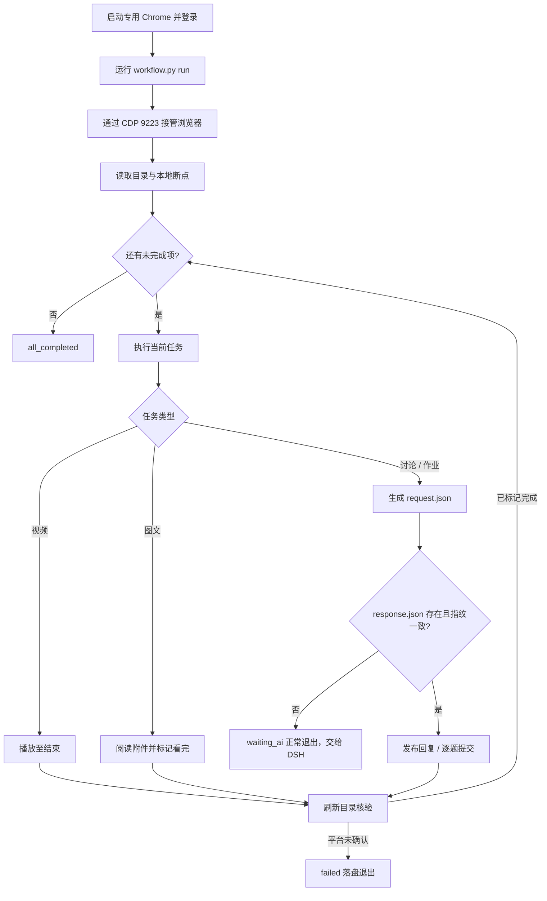

# 学堂在线目录工作流


按新版学堂在线课程目录顺序，逐项处理**视频、图文、讨论、作业**的 Windows 本地工作流。

脚本只负责网页操作、断点记录与结果核验；讨论回复和作业答案通过 `request.json` / `response.json` 与 DSH（DeepSeek Harness）交接，不内置模型 API，也不读取账号密码。

> 这是学习辅助工具，不是无人值守的刷课服务。遇到真实安全验证、题目无法完整读取、发布或提交结果不明时，程序会停下来并保留断点，由人或 DSH 处理。

完整操作见 [使用说明](使用说明.md)；交给 DSH 连续执行时见 [DSH 值守指南](docs/DSH值守指南.md)。

## 目录

- [功能特性](#功能特性)
- [工作流程](#工作流程)
- [环境要求](#环境要求)
- [安装](#安装)
- [快速开始](#快速开始)
- [目录结构](#目录结构)
- [入口与命令行](#入口与命令行)
- [四类任务](#四类任务)
- [DSH 交接](#dsh-交接)
- [断点与状态文件](#断点与状态文件)
- [安全设计与已知边界](#安全设计与已知边界)
- [常见问题](#常见问题)
- [开发与测试](#开发与测试)
- [数据与隐私](#数据与隐私)
- [贡献](#贡献)
- [许可证与来源](#许可证与来源)

## 功能特性

- **严格按目录顺序**：实时读取左侧目录，只处理未完成项，不跳项、不并发。
- **四类任务真实操作**：视频实际播放，图文打开附件阅读并标记看完，讨论填入原创回复，作业逐题填写并提交。
- **平台侧核验**：任务完成后刷新目录，要求出现完成标记；讨论核对本人评论；作业核对提交次数。
- **断点可恢复**：每个状态变化先落盘再执行；重跑不会重复发布或重复提交。
- **失败可解释**：失败原因、时间、当前任务和恢复建议写入状态文件，不用退出码代表课程进度。
- **验证码只提醒**：识别可见的安全验证后弹窗提醒并等待人工完成，不点击、不代答、不刷新。
- **文件式 AI 交接**：请求指纹只覆盖题目/主题等稳定内容，提交状态单独保存，避免“提交一题指纹就漂移”。

## 工作流程



程序在**任务之间**和**视频播放循环内**检查运行时间上限；发布和提交这类短操作不会中途硬截断。等待人工验证的时间也计入上限。

## 环境要求

| 项目 | 要求 |
| --- | --- |
| 操作系统 | Windows 10 / 11 |
| Python | 3.13（需要自带 Tkinter，用于时长弹窗与提醒） |
| 浏览器 | 本机 Google Chrome，通过 CDP 端口 9223 接管 |
| 账号 | 已在专用 Chrome 配置中登录学堂在线 |
| 课程页面 | 新版学习空间，URL 含 `/learn/space/` |
| 依赖 | `playwright>=1.40.0`（无需另外下载 Playwright 浏览器） |

## 安装

```powershell
git clone <你的仓库地址> xuetangzaixian
Set-Location -LiteralPath '<项目目录>'
python -m venv .venv
.\.venv\Scripts\python.exe -m pip install -r requirements.txt
```

本地验证环境：Windows + Python 3.13.5 + Playwright 1.65.2 + Chrome 157。

## 快速开始

1. **启动专用 Chrome**（不要关闭日常使用的浏览器窗口）：

   ```powershell
   & "C:\Program Files\Google\Chrome\Application\chrome.exe" `
     --remote-debugging-port=9223 `
     --user-data-dir="$env:USERPROFILE\.config\google-chrome-brush"
   ```

2. 在该窗口登录学堂在线，打开**新版**课程页（地址包含 `/learn/space/`），只保留**一个**课程标签页。

3. 双击 **`扫描课程目录.cmd`**：只读获取平台最新进度，确认断点与课程一致。

4. 双击 **`继续目录工作流.cmd`**：弹窗选择本次运行上限（分钟，1–1440，默认建议 120），随后按目录顺序处理。

5. 需要 AI 时，脚本会写入 `reports/workflow_ai/<任务ID>/request.json` 并以 `waiting_ai` 退出（退出码 0）。让 DSH 生成同目录 `response.json` 后，再次运行即可继续。

6. 双击 **`查看运行状态.cmd`** 查看断点、等待 AI、失败与最近一次失败原因。

> 一个浏览器标签页、一个工作流进程。不要同时运行多份脚本，也不要在运行中手动切换课程或新旧版页面。

## 目录结构

```text
xuetangzaixian/
├─ README.md                 项目说明（本文件）
├─ 使用说明.md                面向使用者的完整操作手册
├─ LICENSE                   MIT 许可证
├─ requirements.txt          Python 依赖
├─ .gitignore                版本控制忽略规则
├─ .gitattributes           换行符规范（.cmd 使用 CRLF）
├─ 继续目录工作流.cmd         主入口：按目录顺序运行
├─ 扫描课程目录.cmd           只读扫描目录与进度
├─ 查看运行状态.cmd           查看本地断点与失败记录
├─ 课程与单题检查.cmd         导出目录和当前题目（只读）
├─ 准备DSH单题解析.cmd        生成单题请求，准备 AI 解析
├─ 填写当前答案.cmd           填写已有单题答案（不提交）
├─ scripts/
│  ├─ workflow.py            主调度：扫描、执行、断点、发布、核验
│  ├─ chapter_submit.py      章节作业逐题填写与提交（写提交快照）
│  ├─ fill_answer.py         单题填写与提交前校验（不提交）
│  ├─ inspect_course.py      只读解析目录结构与当前题目
│  ├─ dsh_question.py        单题请求生成与响应格式校验
│  ├─ homework_dom.py        新旧两套作业页容器的共用选择器
│  ├─ browser_checks.py      可见验证码识别与人工等待
│  ├─ user_prompts.py        运行时长弹窗与验证码提醒
│  └─ extract_course.py      登录状态与课程基础信息提取（只读）
├─ tests/                    单元测试（本地合成页面，不提交真实作业）
│  ├─ test_workflow.py
│  ├─ test_chapter_submit.py
│  ├─ test_fill_answer.py
│  ├─ test_inspect_course.py
│  ├─ test_dsh_question.py
│  ├─ test_homework_versions.py
│  ├─ test_resume_guards.py
│  ├─ test_browser_checks.py
│  ├─ test_user_prompts.py
│  └─ test_course_readonly.py
└─ docs/
   └─ DSH值守指南.md          交给 DSH 的连续值守任务说明
```

运行时自动创建、**不进入版本库**的目录：

```text
reports/
├─ workflow_state.json              课程绑定、断点、历史与运行结果
├─ workflow_ai/<任务ID>/            request.json / response.json 交接文件
├─ chapter_submission*.json         最近一次及每次运行的作业提交快照
├─ chapter_submission_log.jsonl     作业提交追加日志
└─ course_inspection.json 等        单题检查与核验证据
```

## 入口与命令行

| 入口 | 作用 |
| --- | --- |
| `继续目录工作流.cmd` | 运行 `workflow.py run`，弹窗选择时长 |
| `扫描课程目录.cmd` | 运行 `workflow.py scan`，只读 |
| `查看运行状态.cmd` | 运行 `workflow.py status`，只读本地快照 |
| `课程与单题检查.cmd` | 导出目录与当前题目，不提交 |
| `准备DSH单题解析.cmd` | 读取当前题并生成单题 DSH 请求 |
| `填写当前答案.cmd` | 填写已有单题答案，不提交 |

命令行等价写法：

```powershell
Set-Location -LiteralPath '<项目目录>'
$env:PYTHONUTF8 = '1'
$env:PYTHONIOENCODING = 'utf-8'

# 只读扫描 / 查看状态
.\.venv\Scripts\python.exe scripts\workflow.py scan
.\.venv\Scripts\python.exe scripts\workflow.py status

# 运行；省略 --max-seconds 时弹出时长选择框
.\.venv\Scripts\python.exe scripts\workflow.py run
.\.venv\Scripts\python.exe scripts\workflow.py run --max-seconds 1800

# 只处理部分类型（会跳过其他类型，不再保持严格目录顺序）
.\.venv\Scripts\python.exe scripts\workflow.py run --kind article,discussion,homework

# 可选：2 倍速播放（默认 1 倍速）
$env:XT_VIDEO_RATE = '2'
.\.venv\Scripts\python.exe scripts\workflow.py run --max-seconds 1800
```

退出码：`0` 表示本轮正常结束（`waiting_ai` 或 `all_completed`）；非 `0` 表示带中文原因的失败，需要查看 `workflow_state.json` 的 `last_failure`。

## 四类任务

| 类型 | 脚本动作 | 完成判据 |
| --- | --- | --- |
| 视频 | 等待播放器就绪，自动 `play()`，每秒读取播放进度；90 秒不推进视为异常 | 播放到 `ended` 后，目录出现完成标记 |
| 图文 | 若显示“未阅读”，打开每个附件预览并翻页阅读，再点击“标记看完” | 状态不再是“未阅读”，且目录已完成 |
| 讨论 | 生成主题请求；AI 回复校验后填入编辑器、确认内容一致后再发送 | 评论区出现本人昵称与回复正文，目录已完成 |
| 作业 | 逐题生成请求；AI 答案校验后逐题填写、提交，已提交题跳过 | 每题提交次数大于 0，且目录已完成 |

- 支持的题型：**单选、多选、判断**。
- 填空、简答、含图片或无法完整读取的公式题：不猜测，记为“不支持”；章节仍有未提交题时，按 pending 题号停下。
- 作业提交结果以平台 `my_count` 为准；提交按钮只点击一次，超时不自动重试。

## DSH 交接

请求文件：`reports/workflow_ai/<任务ID>/request.json`。生成响应时先写临时文件，再原子替换 `response.json`，避免脚本读到半截 JSON。

### 讨论

```json
{
  "request_id": "原样复制请求中的 request_id",
  "kind": "discussion",
  "reply": "原创回复正文"
}
```

要求：150–250 字中文，概念准确、紧扣题意，不抄其他学生，不编造个人经历。

### 作业

```json
{
  "request_id": "原样复制章节请求指纹",
  "kind": "homework",
  "answers": [
    {
      "index": 0,
      "question_id": "对应 request.items[0].request.question_id",
      "answer": ["A"],
      "explanation": "分析与计算依据",
      "needs_review": false
    }
  ]
}
```

- `index` 从 0 开始；单选和判断只给一个标签，多选可多个。
- `needs_review: true` 的题默认不提交。确认无误后，在该答案内加 `"reviewed": true` 和非空 `"review_basis"` 才会放行。
- 题目内容变化会导致 `request_id` 变化，旧响应会被拒绝，必须按最新请求重新分析。
- 提交状态（`state_snapshot`）不参与指纹，因此提交一题后无需重做整章答案。

## 断点与状态文件

`reports/workflow_state.json` 主要字段：

| 字段 | 含义 |
| --- | --- |
| `course` | 绑定的课程路径；页面不一致时拒绝运行 |
| `account_nickname` | 首次运行时记录的账号显示名，用于防止串号 |
| `tasks` / `current` | 最近一次目录快照与当前任务 |
| `history` | 每个任务的状态：`running` / `waiting_ai` / `sending` / `completed` / `failed` |
| `run` | 本次运行开始时间、时长上限与结果 |
| `last_failure` | 最近失败的任务、原因与时间 |

关键的防重复规则：

- 讨论发送前先把状态置为 `sending` 并落盘；若评论区没出现回复，状态保持 `sending`，**不会自动重发**。
- 作业提交超时视为“结果未知”，只允许核验平台状态，不允许直接重试。
- 已 `completed` 的任务在恢复时跳过；重启不会清空历史。
- 恢复时不要删除 `reports/`，也不要用新目录覆盖旧断点。

## 安全设计与已知边界

- 不读取账号密码、Cookie 或 DSH 凭据；浏览器登录状态由专用 Chrome 配置保存。
- 不伪造学习进度、不注入心跳、不调用“强制完成”接口；完成状态只认平台目录标记。
- 不识别、不点击、不破解安全验证码；只检测可见验证框并提醒人工处理。
- 同一时间只允许一个课程标签页、一个工作流进程。
- 页面选择器依赖当前平台 DOM，平台改版后可能失效；失效时会报错暂停，而不是跳过。
- 模型答案不保证满分；讨论回复由模型原创生成，发布前脚本只校验格式与一致性。
- 本项目仅用于个人学习辅助，请遵守学堂在线的用户协议与课程要求，风险自担。

## 常见问题

**提示“9223 拒绝连接”？**
专用 Chrome 没有启动或已退出。关闭旧的专用窗口，重新执行快速开始第 1 步后再运行。

**提示“请打开唯一的新版课程标签页”？**
关闭多余的学堂在线标签页，只保留一个 URL 含 `/learn/space/` 的课程页；旧版 `/learn/` 页面不受支持。

**运行停在“等待 DSH”，是卡死了吗？**
不是。这是设计内的交接：`waiting_ai` 表示请求已写好、等待 `response.json`。生成响应后重新运行即可。

**状态是 `sending`，能直接重跑吗？**
不能。先在讨论区核对本人是否已发出该回复；未确认前重跑会被拒绝，以免重复发布。

**出现安全验证怎么办？**
切换到专用 Chrome 手动完成。程序会保留页面并等待，验证消失后自动继续；等待时间计入运行上限。

**2 倍速为什么有时显示 1x？**
日志在点击后过早读取菜单文本，可能显示 1x；实际以播放器状态为准。2 倍速是否计入进度取决于平台，建议先用一个短视频验证。

**运行到一半关闭窗口会怎样？**
已写入的断点会保留；重新运行会从平台最新状态和断点继续。发布/提交进行中被强制中断时，按 `sending` 或失败记录人工核对。

## 开发与测试

```powershell
.\.venv\Scripts\python.exe -m unittest discover -s tests -v
```

当前共 **26 个测试**，约 30 秒，全部使用本地合成 HTML 页面，不访问真实课程、不提交真实作业。测试通过只说明本地逻辑正常，不代表所有平台页面已验收。

修改选择器或提交流程时，至少同步更新对应测试；不要用真实课程作业做回归测试。

## 数据与隐私

- `reports/` 保存课程绑定、账号显示名、题目、AI 回复、发布证据与提交记录，属于本地数据，已加入 `.gitignore`。
- 浏览器登录配置位于 `%USERPROFILE%\.config\google-chrome-brush`，不属于项目文件。
- 提交 issue 或 PR 时，请勿附带 `reports/`、截图、Cookie、账号信息或课程私有题目。

## 贡献

欢迎提交 issue 和 PR，但请遵守以下约定：

1. 不要提交 `reports/`、浏览器配置、Cookie、账号信息或课程私有题目。
2. 修改页面选择器或提交流程时，同步更新 `tests/` 中对应的本地测试。
3. 不要加入绕过验证码、伪造进度、强制完成或重复提交的逻辑。
4. PR 描述中说明改动目的、影响范围和本地测试结果。

## 许可证与来源

本项目基于 [FlapPearLabs/xuetangx-complete](https://github.com/FlapPearLabs/xuetangx-complete) 改造，由 xuetangzaixian contributors 维护，新增目录顺序调度、断点恢复、DSH 文件交接、提交核验和 Windows 运行提醒等功能。

上游 README 明确声明 MIT 许可；本地采用的上游基线没有独立的 LICENSE 文件。沿用代码的权利仍归原权利人所有，本项目的新增贡献以 [MIT License](LICENSE) 发布。新项目名称和新增贡献声明不表示上游代码的版权已经转让。

具体来源、沿用文件、修改范围与上游许可证据见 [第三方来源与许可说明](THIRD_PARTY_NOTICES.md)。分享、修改或再分发本项目时，请一并保留 LICENSE、THIRD_PARTY_NOTICES.md 以及代码中已有的版权和许可声明。MIT 允许在遵守许可条件的情况下使用、修改、分发和商业使用；开源授权不等于放弃版权。

旧版的进度注入、强制完成与复制评论逻辑不属于本仓库的公开工作流，也未包含在本说明所述功能中。
